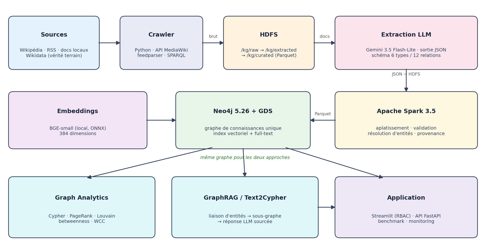
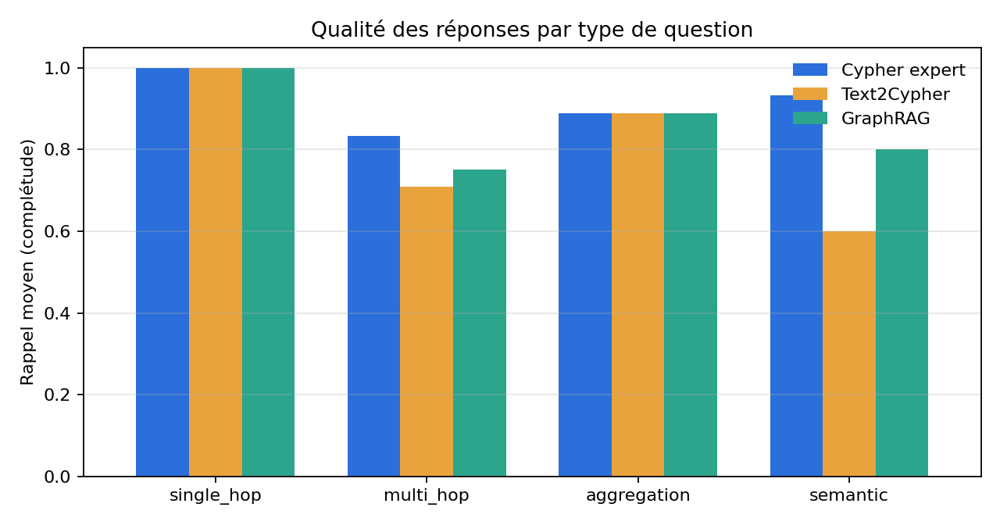
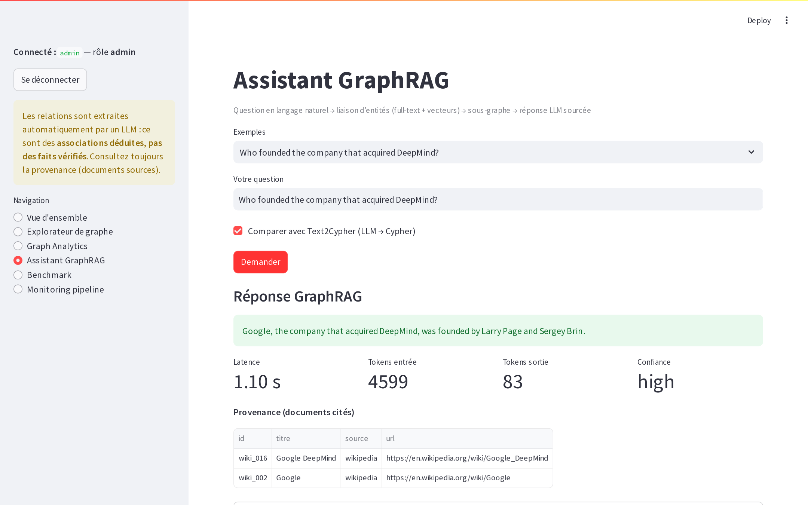
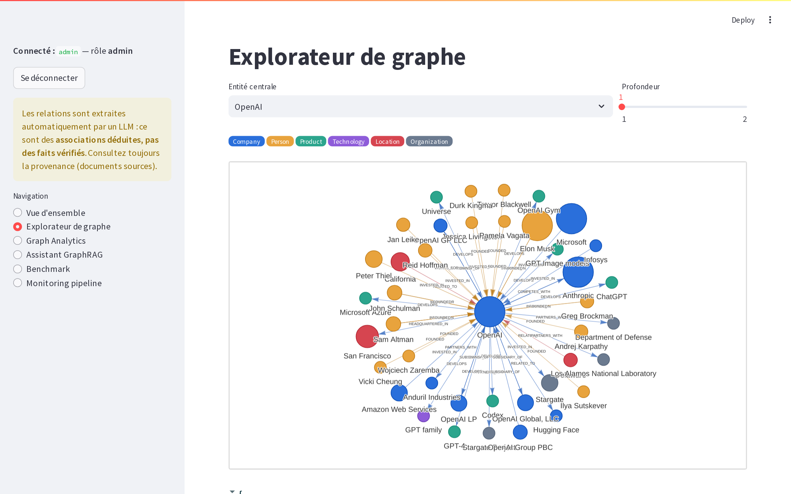
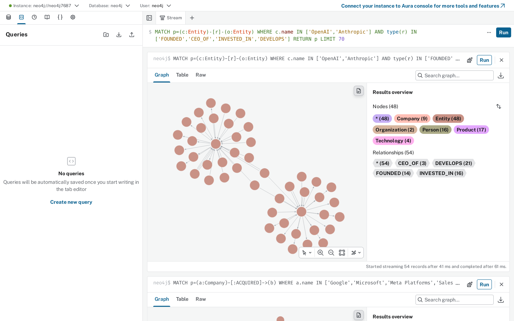
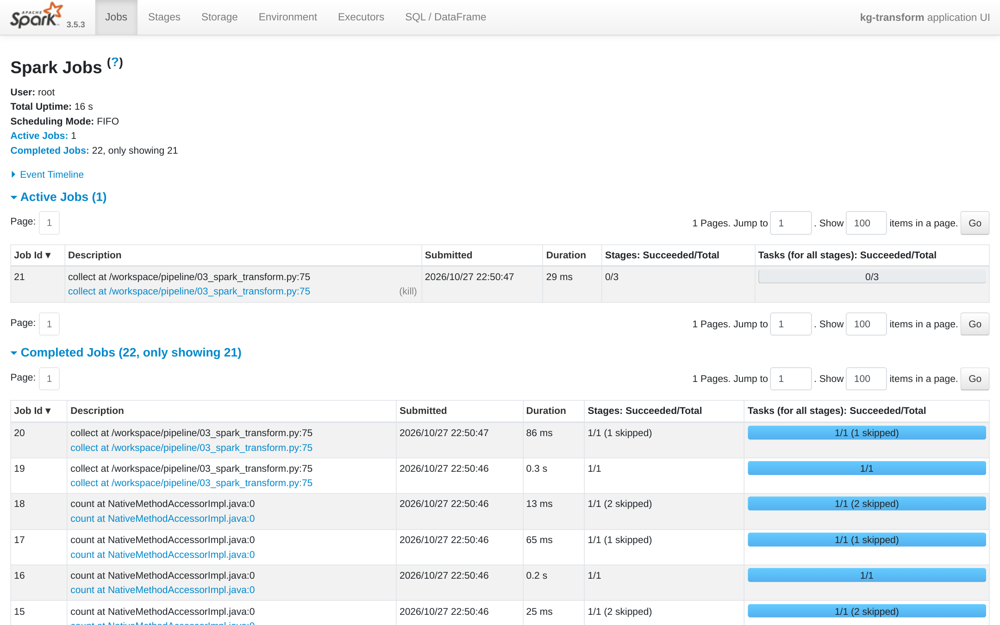

# Plateforme d'analyse de graphe de connaissances propulsée par l'IA

**Big Data · Extraction d'information par LLM · Neo4j · GraphRAG**

> Module **Big Data Analytics** — INPT, filière Innovation & AMOA — 2026–2027
> Réalisé par **AKHI Salma** et **BENTATOU Rania** — encadré par **M. EL GHAZI Hamid**

📄 **Rapport complet :** [Rapport_Projet_Knowledge_Graph.pdf](Rapport_Projet_Knowledge_Graph.pdf)

---

## Objectif

Collecter des sources hétérogènes, en extraire automatiquement entités et relations avec un LLM, construire
**un seul graphe de connaissances** dans Neo4j, puis comparer deux approches d'analyse sur ce même graphe :

* **Graph Analytics** : requêtes Cypher + Neo4j Graph Data Science (PageRank, Louvain, betweenness, WCC)
* **GraphRAG** : liaison d'entités (full-text + vecteurs) → sous-graphe → réponse LLM sourcée

plus **Text2Cypher** (LLM → Cypher) comme troisième point de comparaison, et un benchmark sur 21 questions.
Domaine : l'écosystème des entreprises technologiques (fondateurs, acquisitions, investissements, produits).



## Pipeline

| Phase | Script | Description |
|---|---|---|
| 1. Collecte | `pipeline/01_crawl.py` | Wikipédia (40 articles), flux RSS (18), document local, Wikidata (245 faits, vérité terrain) → HDFS `/kg/raw` |
| 2. Extraction LLM | `pipeline/02_extract.py` | Gemini 3.5 Flash-Lite, JSON contraint par le schéma, phrase de preuve par relation → HDFS `/kg/extracted` |
| 3. Spark | `pipeline/03_spark_transform.py` | Aplatissement, résolution d'entités, validation, provenance → Parquet `/kg/curated` |
| 3b. Neo4j | `pipeline/04_load_neo4j.py` | Chargement, embeddings locaux (BGE-small), index vectoriel et full-text |
| 4. Graph Analytics | `pipeline/05_graph_analytics.py` | PageRank, Louvain, betweenness, degree, WCC + catalogue Cypher |
| 5. GraphRAG | `graphrag/engine.py` | GraphRAG et Text2Cypher |
| 6. Évaluation | `benchmark/` | Rappel vs Wikidata, précision (juge LLM), benchmark 3 approches × 21 questions |
| 7. Application | `ui/`, `api/` | Interface Streamlit (rôles viewer/analyst/admin), API FastAPI, monitoring |

## Résultats principaux

* Graphe : **59 documents → 1 473 entités, 1 324 relations** ; 406 communautés Louvain (modularité 0,86)
* Extraction : **rappel 66 %** (faits Wikidata présents dans le texte), **précision ≈ 72 %** (juge LLM, 60 relations)
* Résolution d'entités : 1 554 formes de surface → 1 473 entités (−5,2 %), 32 conflits de type corrigés

| Approche | Rappel moyen | Latence médiane | Coût (21 questions) |
|---|---|---|---|
| Cypher écrit par un expert | 91 % | 0,05 s | 0 $ |
| GraphRAG | 86 % | 2,0 s | 0,010 $ |
| Text2Cypher | 82 % | 1,0 s | 0,0015 $ |



## Captures

| Assistant GraphRAG | Explorateur de graphe |
|---|---|
|  |  |
| **Neo4j Browser** | **Interface Spark** |
|  |  |

Toutes les captures : [`data/reports/screenshots/`](data/reports/screenshots/).

## Architecture Docker

| Service | Rôle | URL |
|---|---|---|
| `kg-namenode`, `kg-datanode` | HDFS (Hadoop 3.2) — données brutes, extraites, Parquet | http://localhost:9870 |
| `kg-neo4j` | Neo4j 5.26 + GDS + APOC, index vectoriel et full-text | http://localhost:7475 (bolt 7688) |
| `kg-app` | Python 3.11 + PySpark 3.5 : pipeline + interface Streamlit | http://localhost:8501 |
| `kg-api` | API REST FastAPI (GraphRAG, Text2Cypher, analytics) | http://localhost:8000/docs |

## Lancement

Prérequis : Docker Desktop, une connexion Internet, une clé API Gemini gratuite (https://aistudio.google.com/apikey).

```bash
git clone <url-du-depot>
cd projet-kg
cp .env.example .env          # puis remplacer your_gemini_api_key_here par votre clé
docker compose up -d --build  # attendre ~2 min (Neo4j télécharge le plugin GDS au démarrage)
docker compose exec app bash run_pipeline.sh   # phases 1 à 6 (~15 min)
```

Puis ouvrir http://localhost:8501.

* Comptes de démonstration (interface) : `viewer/viewer123`, `analyst/analyst123`, `admin/admin123`
* Clés API : `demo-viewer-key`, `demo-analyst-key` (en-tête `X-API-Key`)
* Neo4j Browser : http://localhost:7475, connexion `neo4j://localhost:7688`, utilisateur `neo4j`, mot de passe `kgpassword123`

## Arborescence

```
common/        config (schéma du graphe), client Gemini, HDFS/Neo4j, résolution d'entités
pipeline/      01_crawl · 02_extract · 03_spark_transform · 04_load_neo4j · 05_graph_analytics
analytics/     catalogue de requêtes Cypher et GDS
graphrag/      moteur GraphRAG + Text2Cypher
benchmark/     questions de référence, benchmark comparatif, évaluation de l'extraction
ui/            interface Streamlit + contrôle d'accès
api/           API REST FastAPI
data/          document local, résultats (JSON, CSV, figures, captures)
```

## Éthique et données

Seules des sources publiques et licites sont collectées (Wikipédia, Wikidata, flux RSS publics). Les relations
sont **déduites automatiquement** et affichées avec leur provenance (documents sources + phrase de preuve) ;
elles ne doivent pas être présentées comme des faits vérifiés. L'accès est contrôlé par rôles.
